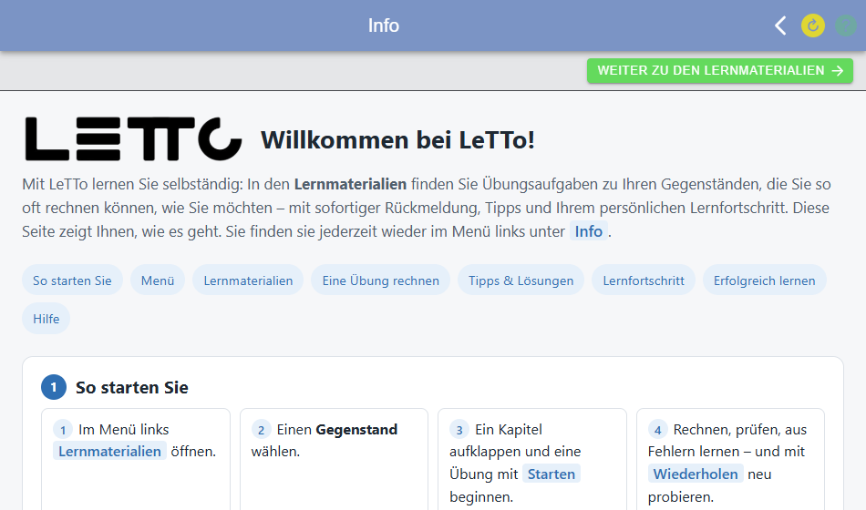

# Info-Seite

Die Info-Seite ist eine Willkommens- und Anleitungsseite, die Schülerinnen und Schüler nach dem Login in der App sehen.
Die Schule kann sie ein- und ausschalten und ihren Inhalt selbst festlegen. **Standardmäßig ist sie ausgeschaltet.**

## Für Schüler

* Nach jedem Schüler-Login (auch beim Wechsel in die Schüler-Rolle) erscheint zuerst die Info-Seite.
* Der Knopf oben rechts führt weiter zur **Startseite** – bzw. zu den [Lernmaterialien](../Lernmaterialien/index.md),
  wenn die Startseite ausgeblendet ist (siehe [Selbstlernen ohne Startseite](../Lernmaterialien/index.md#selbstlernen-ohne-startseite)).
* Im [Menü](../MenueSchueler/index.md) steht der Punkt **Info**, über den die Seite jederzeit wieder geöffnet werden kann.
* Lehrer und LeTTo-Private-Benutzer bekommen weder die Seite noch den Menüpunkt.

## Mitgelieferte Willkommensseite

Mit dem Wert `asset` zeigt die App ihre mitgelieferte Willkommensseite. Sie erklärt das Selbstlernen mit den
Lernmaterialien: erste Schritte, Menü, Lernmaterialien, eine Übung rechnen, Tipps und Musterlösung, Lernfortschritt,
Lerntipps und Hilfe.

Die Seite gibt es in allen Sprachen der App (Deutsch, Englisch, Spanisch, Französisch, Ungarisch). Angezeigt wird die
Sprache, die in der App eingestellt ist; ein Sprachwechsel im Menü stellt die Seite sofort um.

## Einstellung

Eingeschaltet wird die Info-Seite in der `.env` der Installation mit `LETTOSCHOOL_INFO_STARTPAGE` (alle Schulen) bzw.
`LETTO_n_INFO_STARTPAGE` (Schule n) – siehe [LeTTo Environment](../../Administration/Docker/LeTToEnvironment/index.md#app-konfiguration).

| Wert | Wirkung |
|---|---|
| leer, `aus` | keine Info-Seite (Standard), kein Menüpunkt „Info“ |
| `asset` | mitgelieferte Willkommensseite in der eingestellten Sprache |
| `asset:datei.html` | andere Seite aus `assets/info/` der App; gibt es `datei.en.html`, `datei.es.html` usw., wird die Sprachvariante verwendet |
| `link:www.example.at` | eigene Seite im iframe (ohne Protokoll wird `https://` ergänzt, `link:/pfad` für Seiten am selben Server) |
| `html:...` | HTML direkt aus der Variable |

Nach einer Änderung der `.env` den Setup-Service neu starten (oder dessen Startseite aufrufen, damit er die
Konfiguration neu einliest). Externe Seiten bei `link:` müssen die Einbettung im iframe erlauben; für sie gibt es
zusätzlich den Knopf „In neuem Fenster öffnen“.
