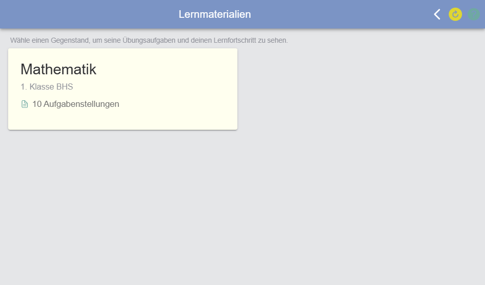
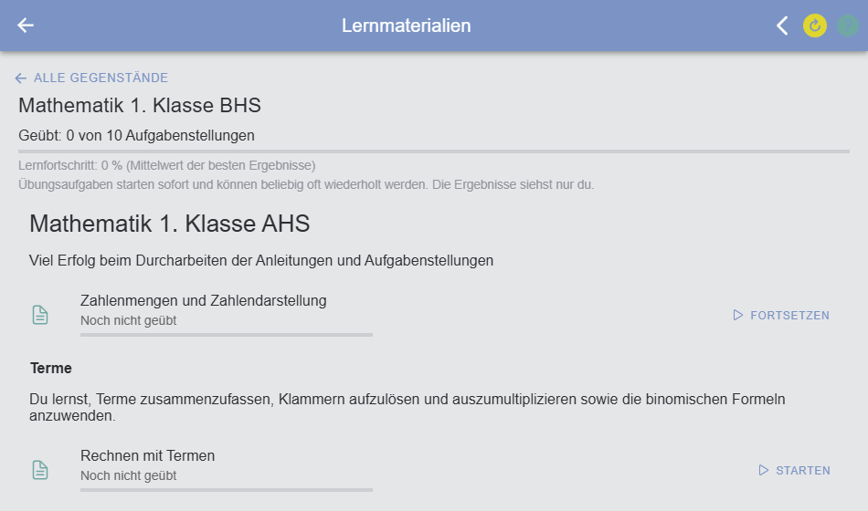

# Lernmaterialien

Unter **Lernmaterialien** finden Schülerinnen und Schüler Übungsaufgaben zum selbständigen Lernen. Die Übungen können
beliebig oft gerechnet werden, mit sofortiger Rückmeldung, Tipps und einem persönlichen Lernfortschritt. Die Ergebnisse
sieht nur der Schüler selbst; sie fließen nicht in die Beurteilung ein.

Die Lernmaterialien stammen aus den [allgemein gültigen Beispielsammlungen](../../Fragen/AllgemeingültigeBeispielsammlungen/index.md)
der Schule. Die Seite heißt in den anderen Sprachen der App *Learning materials*, *Materiales de aprendizaje*,
*Supports d'apprentissage* bzw. *Tananyagok*.

## Welche Lernmaterialien sieht ein Schüler?

Der Menüpunkt **Lernmaterialien** erscheint nur, wenn es für den Schüler Übungsaufgaben gibt. Ein Schüler bekommt die
Klassen (Fächer) eines allgemein gültigen Schuljahres,

* die in **Schultyp** und **Jahrgang** zu einer seiner Klassen im aktuellen Schuljahr passen – z. B. ein Schüler der 1. Klasse
  einer höheren Schule (BHS) bekommt die Klasse „1. Klasse BHS“ der Beispielsammlung, oder
* in denen er **direkt Mitglied** ist – so können auch Benutzer ohne Klasse im aktuellen Schuljahr (z. B. reine
  Selbstlerner) Lernmaterialien bekommen.

Allgemein gültige Schuljahre sind für Schüler **nie das aktuelle Schuljahr**: Ihr Inhalt steht nur unter
Lernmaterialien, nicht auf der Startseite, im Dashboard oder unter „Schuljahre“.

## Übersicht

Zuerst zeigt die Seite alle Gegenstände als Kacheln, jeweils mit der Anzahl der Aufgabenstellungen. Ein Klick auf eine
Kachel öffnet den Gegenstand.

## Ein Gegenstand

* Oben stehen die Anzahl der bereits **geübten** Aufgabenstellungen und der **Lernfortschritt** des Gegenstands.
* Darunter sind die Übungen nach **Kapiteln** (Ordnern) gegliedert. Ein Klick auf ein Kapitel klappt es auf oder zu;
  neben jedem Kapitel steht, wie viel daraus schon geübt wurde. Kapitel können auch Theorie-Teile (Text ohne Eingaben)
  enthalten.
* **Alle Gegenstände** führt zurück zur Übersicht.

## Eine Übung rechnen

| Knopf | Bedeutung |
|---|---|
| **Starten** | Die Übung beginnt sofort – ohne Passwort, ohne Termin, im Übungsmodus. |
| **Fortsetzen** | Ein begonnener Versuch wird dort fortgesetzt, wo er unterbrochen wurde. |
| **Wiederholen** | Neuer Versuch, meist mit neuen Zahlenwerten – so wird der Lösungsweg geübt und nicht das Ergebnis. |

In der Übung werden die Antworten mit **Prüfen** sofort kontrolliert; Tipps, Feedback und Musterlösung stehen zur
Verfügung, soweit die Fragen sie enthalten (siehe [Eingabe von Ergebnissen](../EingabevonResultateninLeTTo/index.md)).

## Lernfortschritt

* Bei jeder Übung stehen die Anzahl der Versuche, das **beste** und das **letzte** Ergebnis.
* Der Balken zeigt das beste Ergebnis: rot unter 50 %, gelb von 50 bis 85 %, grün ab 85 %.
* Eine Übung zählt als **geübt**, sobald sie einmal abgeschlossen oder begonnen und dabei Punkte erreicht wurden.
* Der **Lernfortschritt** eines Gegenstands ist der Mittelwert der besten Ergebnisse aller Übungen; noch nicht geübte
  Übungen zählen 0 %.

## Selbstlernen ohne Startseite

Ist die [Info-Seite](../Info-Seite/index.md) der Schule eingeschaltet, gibt es Lernmaterialien und hat der Schüler im
aktuellen Schuljahr keine Inhalte (seine Klasse hat keine Aktivitäten), werden **Dashboard** und **Startseite** im
[Menü](../MenueSchueler/index.md) ausgeblendet. Der Knopf auf der Info-Seite und der Weg „nach Hause“ in der App führen
dann direkt zu den Lernmaterialien. Teilt eine Lehrperson dem Schüler später Aktivitäten zu, erscheinen
Dashboard und Startseite automatisch wieder.

## Adresse

Die Seite ist in der App unter `/app/pages/lernmaterialien` erreichbar; der frühere Pfad `/app/pages/beispiele` leitet
dorthin weiter.
