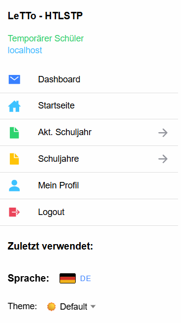
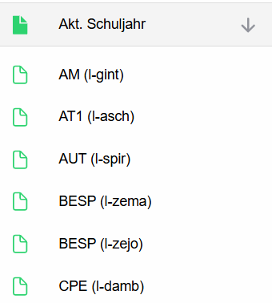
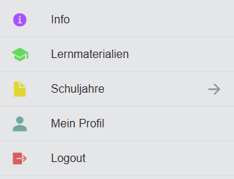
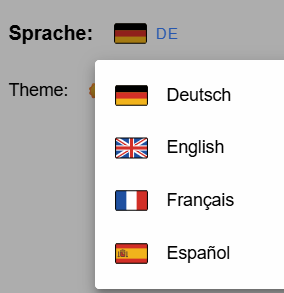

# Menü - Schüler

## Allgemeines Menü
Über das Menü kann in der Anwendung navigiert werden. 
Kurzbeschreibung der Menü-Einträge:
* **Dashboard:** Liefert für den Schüler ein [Dashboard](../Dashboard/index.md) mit allen Aktivitäten, die bearbeitet werden sollen.
* **Startseite:** Link zur Startseite für den Benutzer ([Akt. Schuljahr](../../Tests/Schuljahr_neu/index.md)) damit wird der Benutzer auf die Übersicht für das aktuelle Schuljahr umgeleitet. 
* **Info:** Öffnet die [Info-Seite](../Info-Seite/index.md) der Schule. Nur vorhanden, wenn die Schule die Info-Seite eingeschaltet hat.
* **Lernmaterialien:** Übungsaufgaben zum selbständigen Lernen mit Lernfortschritt – siehe [Lernmaterialien](../Lernmaterialien/index.md).
  Nur vorhanden, wenn es für den Schüler Lernmaterialien gibt.
* **Akt. Schuljahr:** Aufklappbare Liste mit allen Gegenständen, die akt. Schuljahr verfügbar sind.  
* **Schuljahre:** Aufklappbare Liste mit allen verfügbaren Schuljahren, damit kann auch auf Aktivitäten von früheren Schuljahren zugegriffen werden.
* **Mein Profil:** Seite zur [Konfiguration des User-Profils](../../Konfiguration/Mein-Profil), damit können Sie vor allem ihr Passwort ändern.
* **Logout:** Abmelden von der Anwendung

### Selbstlernen ohne Startseite
Sind **Info** und **Lernmaterialien** im Menü und hat der Schüler im aktuellen Schuljahr keine Inhalte (seine Klasse hat
keine Aktivitäten), werden **Dashboard** und **Startseite** ausgeblendet – das Menü enthält dann nur, was zum
Selbstlernen gebraucht wird:

Sobald eine Lehrperson Aktivitäten zuteilt, erscheinen Dashboard und Startseite wieder. Allgemein gültige Schuljahre
(Beispielsammlungen) stehen für Schüler nicht unter **Schuljahre**, ihr Inhalt ist unter **Lernmaterialien** zu finden.

## Zuletzt verwendete Aktivitäten
Unter zuletzt verwendet finden Sie eine Liste von zuletzt bearbeiteten Aktivitäten.
Über diese Links können Sie rasch zuletzt bearbeitete Aktivitäten wieder fortsetzen.

## Konfiguration für die Seite
* **Sprache:** Auswahl der gewünschten Sprache der App:  
* **Themen-Auswahl**: Auswahl des gewünschten Designs für die Anwendung (hell/dunkel/...) 