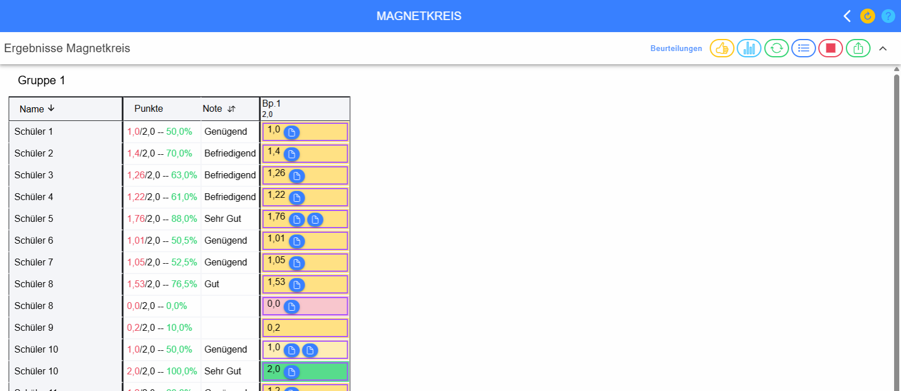
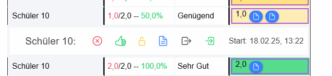
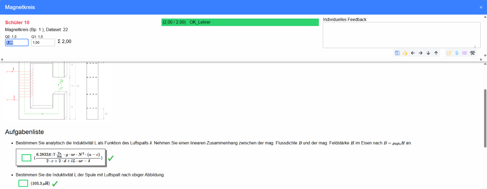
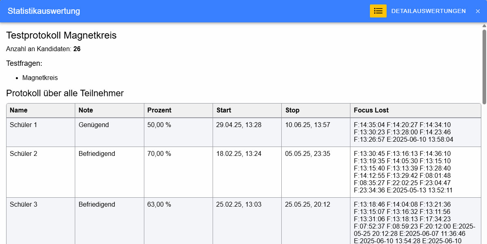

# Test-Ergebnisse / Aktivität-Ergebnisse

Die Ergebnisübersicht zeigt alle Versuche einer Online-Aktivität (Test, Hausübung, Abgabe …) mit Punkten, Note und den
Ergebnissen jeder einzelnen Frage. Sie wird über den Menüpunkt **Ergebnisse** der Aktivität geöffnet.

Die Namen der Schüler sind in den Screenshots durch „Schüler 1, 2, …“ ersetzt.

## Symbolleiste

Rechts oben über der Tabelle:

* **Beurteilungen** – öffnet alle Beurteilungen dieses Gegenstandes (Katalog).
* **Daumen hoch** – alle Versuche neu beurteilen. Vom Lehrer festgelegte Beurteilungen bleiben erhalten.
* **Diagramm** – Statistik über alle Noten und Prozentwerte, dort auch das [Testprotokoll](#testprotokoll).
* **Raster** (nur bei [gruppierten Fragen](../FragenGruppieren/index.md)) – gruppierte Fragen gemeinsam oder jede Frage
  einzeln anzeigen.
* **Pfeile im Kreis** – automatisches Aktualisieren (Polling) der Ergebnisse ein- und ausschalten; sinnvoll, während
  eine Aktivität läuft.
* **Liste** – die Beispielnummern der Schüler (Reihenfolge, in der der Schüler die Frage bekommen hat) in den
  Ergebniszellen ein- oder ausblenden.
* **Stopp** – Aktivität beenden und die Ergebnisse für die Schüler freigeben.
* **Teilen** – Datenimport und -export der Ergebnisse (zB. Download aller abgegebenen Dateien).
* **Pfeil nach oben** – Symbolleisten ausblenden, um mehr Platz für die Tabelle zu haben; eingeblendet werden sie
  wieder über das Auge-Symbol rechts oben.

## Tabelle

* **Name** – Name des Schülers, beim Darüberfahren wird das Foto angezeigt. Ein Klick auf die Spaltenüberschrift sortiert
  nach dem Namen.
* **G** – Schülergruppe (nur, wenn die Klasse in Gruppen geteilt ist).
* **Punkte** – erreichte / mögliche Punkte und Prozentwert. „-----“ bedeutet, dass der Schüler die Aktivität noch nicht
  gestartet hat, „Test blockiert“, dass sie für ihn gesperrt wurde.
* **Note** – Note des Versuchs; sie wird erst angezeigt, wenn der Versuch abgeschlossen ist.
* **Bp.1, Bp.2, …** bzw. **Gr.1, …** – eine Spalte je Frage bzw. Fragengruppe mit den Punkten. Unter der Bezeichnung
  stehen die möglichen Punkte; beim Darüberfahren werden die Fragen der Spalte angezeigt. Ein Klick auf die
  Spaltenüberschrift öffnet einen Dialog, in dem für diese Frage bei allen Schülern
  * die **Punkte geändert** und alle Versuche neu beurteilt,
  * alle Versuche **neu beurteilt** (wahlweise auch die vom Lehrer beurteilten) und
  * alle **abgegebenen Dateien als ZIP** heruntergeladen werden können.

In den Ergebniszellen bedeutet:

* **grün** – richtig gelöst, **dunkelgrün** – vom Lehrer als richtig beurteilt
* **gelb** – teilweise richtig
* **rot** – falsch
* **grau** – noch nicht beurteilt (zB. gespeichert, aber noch nicht abgegeben)
* **violetter Rahmen** – die Frage, die der Schüler zuletzt geöffnet hat (während einer laufenden Aktivität die gerade
  bearbeitete Frage)
* **blaues Dokument-Symbol** – vom Schüler abgegebene Datei, **gelbes Dokument-Symbol** – Korrektur- bzw.
  Feedback-Datei des Lehrers; ein Klick lädt die Datei herunter.

Eine **rot hinterlegte Zeile** zeigt einen **Fokusverlust** an: Der Schüler hat im geschützten Modus die Aktivität
verlassen. Über das rote Schloss-Symbol links oben wird der Fokusverlust für alle Teilnehmer aufgehoben, für einen
einzelnen Schüler über die Aktionen seines Versuchs.

## Aktionen eines Versuchs

Ein Klick auf eine Zeile zeigt darunter eine Leiste mit dem Namen, dem **Startzeitpunkt** des Versuchs und den Aktionen:

* **rotes X** – Versuch löschen
* **Daumen hoch** – diesen Versuch neu beurteilen (Lehrer-Beurteilungen bleiben erhalten)
* **Schloss** – abgeschlossenen Versuch wieder für Eingaben öffnen bzw. (rot) den Fokusverlust aufheben
* **Stopp** (nur bei laufendem Versuch) – Versuch beenden und beurteilen
* **Dokument** – PDF des Versuchs erstellen
* **Abmelden** – den Schüler abmelden
* **Anmelden** – als dieser Schüler einloggen (Rolle wechseln)

Hat ein Schüler noch keinen Versuch, kann für ihn ein Versuch **angelegt** oder die Aktivität für ihn **blockiert**
werden. Ist für die Aktivität eine fixe Reihenfolge der Fragen eingestellt, kann zusätzlich die Startfrage festgelegt
werden.

## Mehrere Versuche derselben Person

Hat eine Person eine Aktivität mehrmals durchgeführt (zB. bei mehreren erlaubten Versuchen oder bei Abgaben von Dateien),
wird **jeder Versuch in einer eigenen Zeile** angezeigt. Die Zeilen derselben Person stehen untereinander.

* Die Versuche werden nach dem **Startzeitpunkt** geordnet und dann nach dem Namen sortiert. Bei derselben Person steht
  daher immer der **ältere Versuch oben und der neuere unten**.
* Das gilt auch, wenn die Übersicht nach einer anderen Spalte (zB. Note) sortiert wird: Bei gleichem Wert bleibt
  der ältere Versuch vor dem neueren.
* Den genauen Startzeitpunkt eines Versuchs sieht man, wenn man seine Zeile anklickt (siehe
  [Aktionen eines Versuchs](#aktionen-eines-versuchs)). Start- und Stopzeit aller Versuche stehen auch im
  [Testprotokoll](#testprotokoll).

## Ergebnis einer Frage

Ein Klick auf eine Ergebniszelle öffnet die Frage mit den Eingaben des Schülers:

* Oben links stehen Name, Frage, Beispielnummer des Schülers und Datensatz, rechts daneben die erreichten Punkte und die
  Beurteilung.
* Für jede Teilfrage (**Q0, Q1, …**) sind die möglichen und die erreichten Punkte angegeben. Die erreichten Punkte können
  überschrieben werden; die Summe wird automatisch mitgerechnet. Damit gilt die Frage als vom Lehrer beurteilt.
* **Individuelles Feedback** – Rückmeldung an den Schüler zu dieser Frage.
* Darunter wird die Frage mit den Eingaben des Schülers und den richtigen Ergebnissen angezeigt.

Die Symbole unter dem Feedback:

* **Diskette** – Änderungen übernehmen
* **Daumen hoch** – Frage neu automatisch beurteilen; ist die Frage vom Lehrer beurteilt (gelber Daumen), wird diese
  Beurteilung dabei aufgehoben
* **Pfeil links / rechts** – vorige / nächste Frage desselben Schülers
* **Pfeil unten / oben** – nächster / voriger Schüler bei derselben Frage
* **Stift** – Angabewerte (Datensatz) des Beispiels bearbeiten
* **Büroklammer** – Feedback-Datei des Lehrers hochladen
* **Liste** – alle gespeicherten Antworten des Schülers zu dieser Frage anzeigen
* **Werkzeug** – Frage im Editor bearbeiten, zB. wenn die Frage fehlerhaft ist

## Testprotokoll

Das Testprotokoll wird in der **Statistik** (Diagramm-Symbol in der Symbolleiste) über den Button **Protokoll** angezeigt.

Oben stehen der Name der Aktivität, die Anzahl der Kandidaten und die Testfragen, darunter für jeden Teilnehmer Note,
Prozentwert, Start- und Stopzeit und die protokollierten Ereignisse:

* **F**: Zeitstempel, an dem der Schüler die Aktivität (zB. nach einer Unterbrechung) fortgesetzt hat
* **E**: Zeitstempel, an dem der Schüler die Ergebnisse abgerufen hat
* **O**: Zeitstempel, an dem der Lehrer die Aktivität nach einem Fokusverlust wieder geöffnet hat
* **X**: Zeitstempel eines Fokusverlusts

## Ergebnisse einer Befragung

siehe [Anonyme Befragung](../AnonymeBefragung/index.md)
