# LTI-Service

> **Hinweis:** Diese Seite beschreibt Installation und Anbindung des LTI-Service (Docker). Die Verbindung zur Plattform (Punkt **Plattformen**) wird im
> **älteren LeTTo-Server** unter „LTI-Konfiguration“ eingetragen. Die Einstellungen der Schule (Benutzer und Kurse automatisch anlegen) stehen in der neuen
> Oberfläche unter [LTI-Konfiguration](../lti/index.md).
##  Allgemeines zu LTI
[LTI](https://www.imsglobal.org/activity/learning-tools-interoperability) kann für die Anbindung von [LeTTo über LTI](https://docs.moodle.org/501/en/LTI_and_Moodle) ab einen [Moodle-Server](https://moodle.com) verwendet werden.

Die Anbindung erfolgt über das LTI-Service welches in einem eigenen Docker-Container läuft.

alte LTI-Lösung (ohne Docker) siehe [LTI-Verbindung alt](lti-old.md)

### So läuft ein LTI-Start ab

```text
Moodle (Aktivität „LeTTo“)
  1. Moodle ruft  https://<server>/lti/oidc/login_initiations  auf        (LTI-Service)
  2. Der LTI-Service schickt den Browser zu Moodle (mod/lti/auth.php) zurück
  3. Moodle sendet ein signiertes Token (id_token) an  https://<server>/lti/lti3
     → der LTI-Service prüft es mit dem Schlüssel der Plattform (Plattform-KID, siehe unten)
  4. Seite „Go to LeTTo“ → Button → LTI-Service (/lti/open/ltilogin)
  5. Der Data-Service der Schule sucht den Benutzer (oder legt ihn an) und ordnet ihn dem Kurs zu
  6. Der Login-Service stellt ein Token aus, der Browser landet in der LeTTo-App
```

Schlägt ein Schritt fehl, hilft die Tabelle [Fehlersuche](#fehlersuche) am Ende der Seite.

## Installation des LTI-Services
* wähle "update-config" im Setup-Service(/config)<br>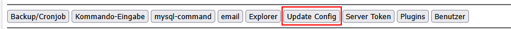
* wähle unten bei den verfügbaren yml-Files bei lti "install Service"<br>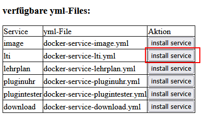
* starte das LTI-Service<br>
* Verbinde mit dem Letto-Server der Schule als globaler Administrator. Wechsle zur Rolle "Global" und zum Punkt "LTI-Konfiguration"<br>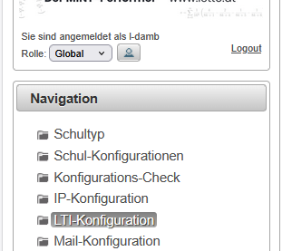
* Initialisiere die LTO-Verbindung mit "LTI-Verbindung initialisieren".<br>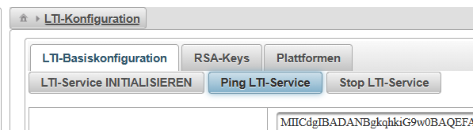
* Prüfe die Verbindung mit "Ping LTI-Service". Es sollte "Ping war erfolgreich" angezeigt werden.
* Wechsle auf Platformen und klicke auf "Neue Plattform erzeugen"
* Fülle die Felder wie folgt aus:
  * URL: die URL des Moodle-Servers, zB https://moodle.htlstp.ac.at
  * OIDC-, JWKS- und OAUTH2-Endpunkt werden aus der URL ergänzt (Moodle: `/mod/lti/auth.php`, `/mod/lti/certs.php`, `/mod/lti/token.php`).
  * **Client-ID** und **Deployment-ID** kommen von Moodle und stehen erst nach dem Anlegen des externen Tools zur Verfügung (siehe nächster Abschnitt):
    die Client-ID in den „Tool-Konfigurationsdetails“ des Tools, die Deployment-ID ist die Nummer des Tools (beim ersten Tool 1).
  * **Plattform-KID** muss die Schlüssel-ID (`kid`) des Moodle-Servers sein: sie steht in der Adresse `https://<moodle>/mod/lti/certs.php`
    (`"kid": "…"`). Der LTI-Service sucht damit den öffentlichen Schlüssel von Moodle zur Prüfung des Tokens. Ein beliebiger Wert genügt **nicht**: der Start bricht dann mit Fehler 500 ab.
  * Die **Tool-KID-ID** wird aktuell nicht ausgewertet (zB. `OWNKEY` eintragen).
  * Speichere die Plattform mit "speichern"<br>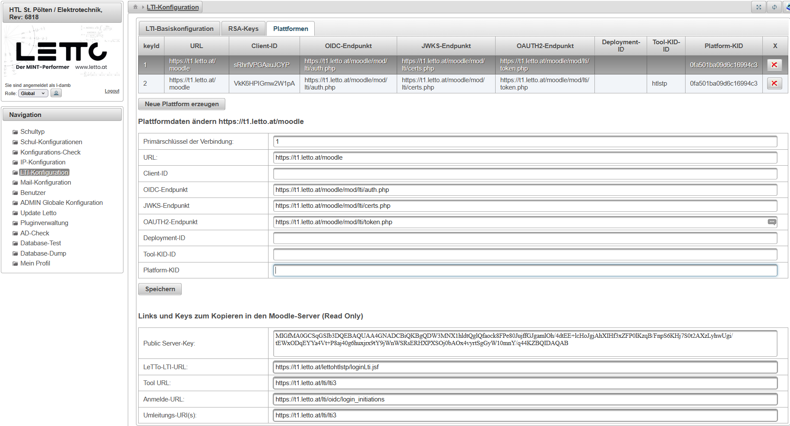
  * Die Werte im Unteren Bereich "Links und Keys" werden für die Konfiguration des externen Tools am Moodle-Server benötigt.
  * Ändert sich der Schlüssel von Moodle (zB. nach einer Neuinstallation von Moodle), muss die Plattform-KID nachgetragen werden.

## LTI-Verbindung im Moodle konfigurieren
* Am Moodle als Administrator anmelden
* Gehe zu "Website-Administration" -> "Plugins" -> "External tool" -> "Manage tools"
* Klicke auf "Neues Werkzeug hinzufügen"
* Kurze Erklärung der Felder:

| -                                                   |                                                                                                                                                                            | Beispiel                                       |
|-----------------------------------------------------|----------------------------------------------------------------------------------------------------------------------------------------------------------------------------|------------------------------------------------|
| Name des Tools                                      | Ist frei vergebbar aber sinnvollerweise **LeTTo**                                                                                                                          | LeTTo                                          |
| Tool-URL                                            | Wird aus dem Formular der Plattform-Konfiguration von LeTTo übernommen.                                                                                                    | https://t1.letto.at/lti/lti3                   |
| Tool-Beschreibung                                   | frei wählbar                                                                                                                                                               | LeTTo t1 Testserver                            |
| LTI-Version                                         | LTI 1.3                                                                                                                                                                    | LTI 1.3                                        | 
| Client-ID                                           | Wird erst beim Speichern des externen Tools berechnet. Zum Auslesen der Client-ID muss nach dem Speichern des externen Tools nochmals das externer Tool bearbeitet werden. |                                                |
| öffentlicher Schlüssel                              | Wird aus dem Formular der Plattform-Konfiguration von LeTTo übernommen.                                                                                                    |                                                |
| Anmelde-URL                                         | Wird aus dem Formular der Plattform-Konfiguration von LeTTo übernommen.                                                                                                    | https://t1.letto.at/lti/oidc/login_initiations |
| Umleitungs-URI(s)                                   | Wird aus dem Formular der Plattform-Konfiguration von LeTTo übernommen.                                                                                                    | https://t1.letto.at/lti/lti3                   |
| Angepasste Parameter                                | **`school=<Schulkürzel>` ist Pflicht** (ohne diesen Parameter bricht die Anmeldung mit einer leeren Fehlermeldung ab). Weitere Parameter (`kursname=…`, Link eines Tests) siehe unten. | school=htlstp                                  |
| Services                                            | werden aktuell noch nicht verwendet                                                                                                                                        |                                                |
| Datenschutz - Anwendernamen an Tool übergeben       | Immer                                                                                                                                                                      | Immer                                          |
| Datenschutz - Email des Anwenders an Tool übergeben | Immer                                                                                                                                                                      | Immer                                          |
| Datenschutz - Bewertungen aus dem Tool akzeptieren  | Immer                                                                                                                                                                      | Immer                                          |
* Beispielhafte Konfiguration des externen Tools am Moodle-Server (Test-Server t1):

  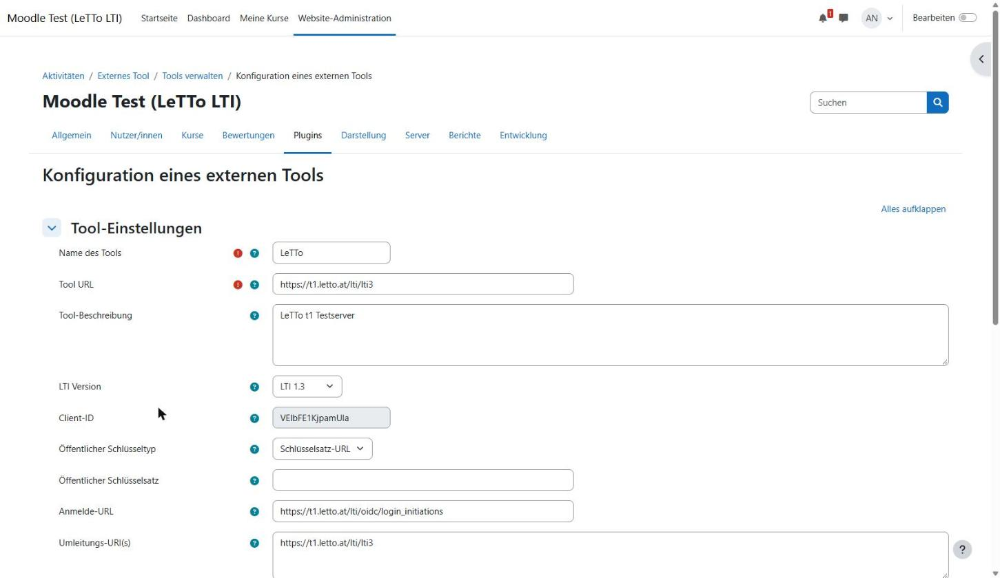

  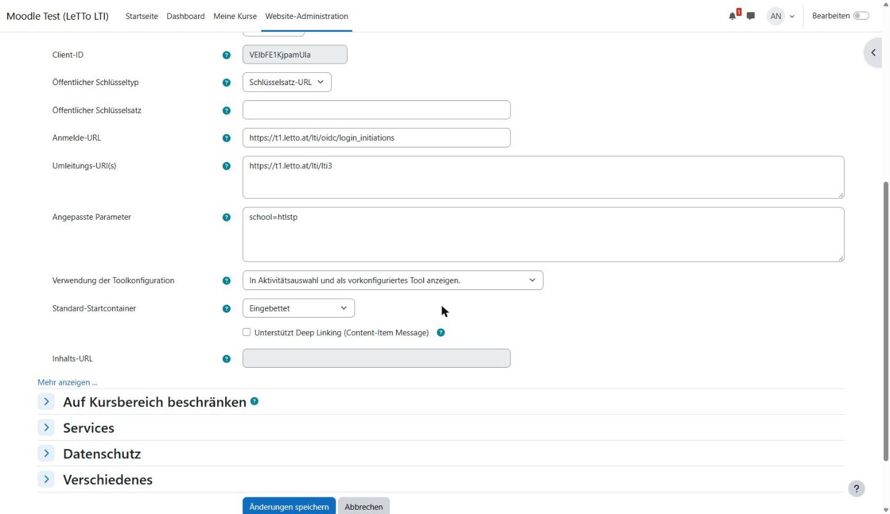

* Die Adressen des LeTTo-Servers und der Public-Key kann aus der LeTTo-Konfigurationsseite übernommen werden.
* Name und Email-Adresse müssen im Punkt "Privacy" mitgeschickt werden!
* Nach dem Speichern zeigt Moodle beim Tool die **Tool-Konfigurationsdetails**: Plattform-ID, Client-ID, Deployment-ID, öffentliche Schlüsselgruppen-URL (= JWKS-Endpunkt),
  Zugriffstoken-URL und Authentifizierungsanfrage-URL. Client-ID und Deployment-ID von dort in die Plattform in LeTTo übernehmen.
* Das Tool soll für Lehrer in der Aktivitätsauswahl sichtbar sein („In Aktivitätsauswahl anzeigen“), sonst kann es in Kursen nicht als Aktivität angelegt werden.

## LTI-Verbindung in einem Moodle-Kurs verwenden
* Am Moodle als Lehrer anmelden
* Wechsle zu "Beispiele Editieren" oder "Beispielsammlung"
* Erzeuge eine neue Online-Aktivität und füge Beipspiele hinzu.
* Erstelle einen LTI-Link des erstellten Tests<br>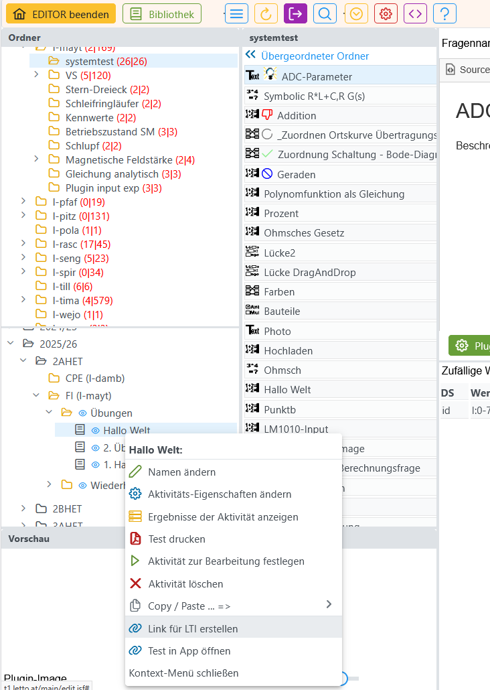
* Kopiere den LTI-Link in die Zwischenablage<br>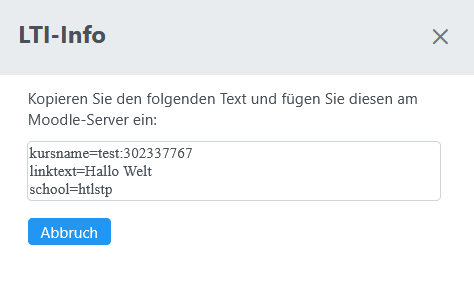
* Erstelle in einem Moodle-Kurs eine Aktivität als LeTTo-Tool und füge die Daten des LTI-Link 
  als Custom -Parameters hinzu<br>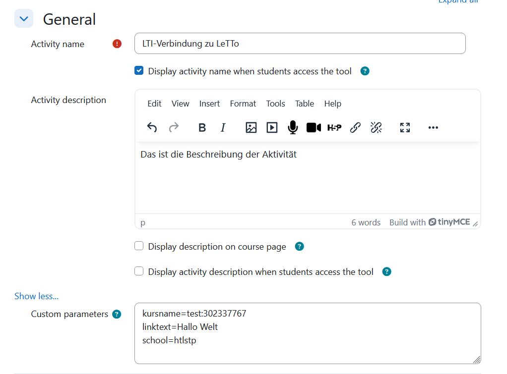
* Der Student kann nun über diese Aktivität mit dem LeTTo-Server über einen Button verbunden werden.

### Aktivität in Moodle und Anmeldung in LeTTo
Ruft ein Teilnehmer die Aktivität auf, zeigt Moodle die Seite **Go to LeTTo**. Der Button führt in die LeTTo-App.

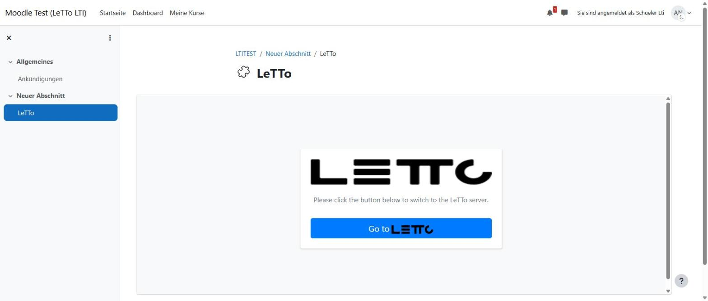

Nach dem Klick ist der Teilnehmer in der LeTTo-App angemeldet (links Name und Server). Enthält die Aktivität den Parameter `kursname=test:<ID des Tests>`, öffnet die App den Test
gleich (im Bild „Newton-Gesetze“ mit dem Button „Neuen Versuch starten“). Ohne Test-Angabe (zB. `kursname=_self`) meldet die App, dass kein Test gefunden wurde (`test_not_found`).

**Wo stehen die Parameter?** `school` gilt für das ganze Tool (Einstellung des externen Tools). `kursname` gehört in die **Aktivität** (Feld „Angepasste Parameter“ der Aktivität),
weil er je Aktivität verschieden ist. Steht `kursname` im Tool, überschreibt er die Angabe der Aktivität und alle Aktivitäten öffnen denselben Kurs statt des gewünschten Tests.

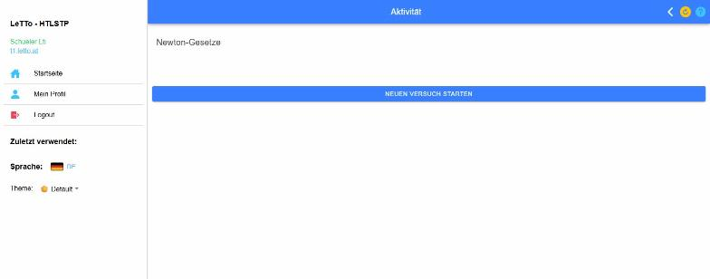

## Benutzer und Kurse bei der Anmeldung
Welcher LeTTo-Benutzer zum Moodle-Benutzer gehört, bestimmt der **eindeutige Bezeichner** in der [LTI-Konfiguration](../lti/index.md) (Moodle-Name, E-Mail oder vollständiger Name).
Die Schule entscheidet dort auch, was automatisch angelegt wird.

| Fall | Verhalten |
|---|---|
| Benutzer ist in LeTTo vorhanden | Anmeldung, bei einem Schüler zusätzlich Zuordnung zum Kurs (wenn „Automatisch in Kurs einschreiben“ aktiv ist) |
| Schüler ist neu | wird angelegt, wenn „Benutzer automatisch anlegen“ aktiv ist, sonst Fehlermeldung „Laut LTI-Konfiguration kann kein neuer Student/Schüler … angelegt werden“ |
| Schüler und Kurs | Der Kurs muss in LeTTo schon vorhanden sein: gefunden wird er über die Moodle-Kurs-ID, die Klassen-ID (`kursname=kurs:<ID>`) oder einen Test (`kursname=test:<ID>`). Sonst: „Geforderter Kurs konnte nicht gefunden werden“ |
| Lehrer ist neu | wird angelegt, aber **deaktiviert**: ein Administrator muss ihn freischalten, bevor er sich anmelden kann |
| Lehrer und neuer Kurs | `kursname=_self` legt den Kurs mit dem Namen des Moodle-Kurses an (`_self:ET` ordnet ihn der Abteilung ET zu), wenn „Kurse automatisch anlegen“ aktiv ist |
| Benutzer ist **archiviert oder deaktiviert** | Die Anmeldung wird abgewiesen, es entsteht weder ein Token noch ein zweiter Benutzer mit demselben Namen. Siehe [Archivierte Benutzer](../../Administration/Setup-Service/Archivierte-Benutzer/index.md) |

## Fehlersuche
Die Meldungen stehen im Browser (LTI-Fehlerseite) und im Log des Containers `letto-lti` (`docker logs letto-lti`).

| Anzeige / Log | Ursache und Abhilfe |
|---|---|
| Moodle startet die Aktivität, `/lti/lti3` liefert Fehler 500, im Log „JWT String argument cannot be null or empty“ | Das Tool in Moodle ist nicht auf **LTI 1.3** eingestellt (Moodle startet dann nach dem alten LTI 1.1 ohne Anmeldeanfrage). LTI-Version des Tools prüfen. |
| Fehler 500 beim Start, im Log „jwk is null“ (NullPointerException) | Die **Plattform-KID** stimmt nicht mit der Schlüssel-ID aus `https://<moodle>/mod/lti/certs.php` überein. |
| Fehler 500 auf `/lti/oidc/login_initiations`, im Log „NoClassDefFoundError: javax/xml/bind/DatatypeConverter“ | älterer Stand des LTI-Service (bis 19.11.2026; die Bibliothek jjwt braucht unter Java 25 zusätzlich `jaxb-api`): LTI-Service aktualisieren. |
| „Error trying to process the Letto-LTI 3 launch“ ohne Text | Der benutzerdefinierte Parameter `school` fehlt im Tool oder in der Aktivität. |
| „Geforderter Kurs konnte nicht gefunden werden“ | Der Schüler hat in LeTTo noch keinen Kurs zur Moodle-Kurs-ID: zuerst als Lehrer mit `kursname=_self` starten oder den Kurs mit dieser ID in LeTTo anlegen. |
| „Laut LTI-Konfiguration …“ | Die Schul-Einstellung in der [LTI-Konfiguration](../lti/index.md) erlaubt das Anlegen oder Einschreiben nicht. |
| „Falscher RestKey“ beim Ping oder Speichern der Plattform | Der RestKey im LTI-Service stimmt nicht mit dem des LeTTo-Servers überein: im LeTTo-Server unter LTI-Konfiguration „LTI-Verbindung initialisieren“. |
| „Der Benutzer ist archiviert …“ | Der Benutzer wurde im Setup archiviert: Archivierung aufheben oder Login ändern. Ältere Stände des Data-Service zeigten stattdessen eine SQL-Meldung „Duplicate entry … for key 'user.Name'“. Meldung siehe Bild unten. |


