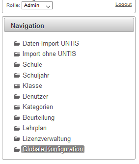

# Schul-Administrator

> **Alte Oberfläche:** Diese Seite beschreibt den bisherigen LeTTo-Server. Die aktuelle Beschreibung steht unter [Administration in LeTTo](../index.md).
###  Allgemeines 
 

* [Daten-Import UNTIS](../Datenimport/index.md)
* [Import ohne UNTIS](../DatenimportohneUntis-Daten/index.md)
* [Schule](../schule)
* [Schuljahr](../../Tests/Schuljahr/index.md)
* [Klasse](../Klasse/index.md)
* [Benutzer](../../Konfiguration/Benutzer-alt/index.md)
* [Kategorien](../ordner)
* [Beurteilung](../../Beurteilungen/Beurteilungskonfiguration/index.md)
* Lehrplan
* [Lizenzverwaltung](../lizenzen)
* [Globale Konfiguration](../global/GlobaleKonfiguration/index.md)

###  siehe auch 
* [Benutzer](../../Konfiguration/Benutzer-alt/index.md)
* [Globaler Administrator](../global/index.md)

[Administration](../../Administration/index.md)

